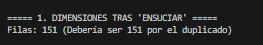
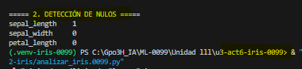
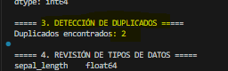
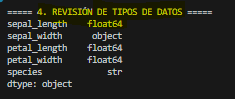
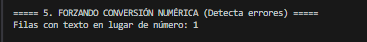
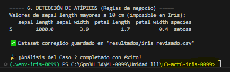
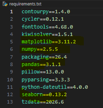

# 🕵️‍♂️ Práctica: Identificación de Problemas en los Datos

> **⏱️ Duración:** 2 horas  
> **🎯 Nivel:** Cero a principiante  
> **🤖 Área:** Machine Learning (Data Cleaning)  
> **💻 Herramientas:** Python, VS Code, Pandas, NumPy, Seaborn  

---

## 🎯 Propósito de la Práctica
Que los estudiantes aprendan a revisar conjuntos de datos (*datasets*) e identifiquen los problemas más comunes que pueden arruinar el entrenamiento de un modelo de Machine Learning. 

Trabajaremos con dos escenarios reales:
1. **Caso 1: Pasajeros del Titanic** 🚢 (Detección de problemas reales: nulos, duplicados, tipos y atípicos).
2. **Caso 2: Flores Iris** 🌸 (Detección de problemas simulados para aprender a depurar).

## 

## deimenciones tras "ensuciar

## Deteccion de nulos 

## 3. deteccion de duplicados 
 

## 4.revision de tipos de datos 

## 5.forzando conversion numerica 

## 6.deteccion de atipicos

## requieriments 
